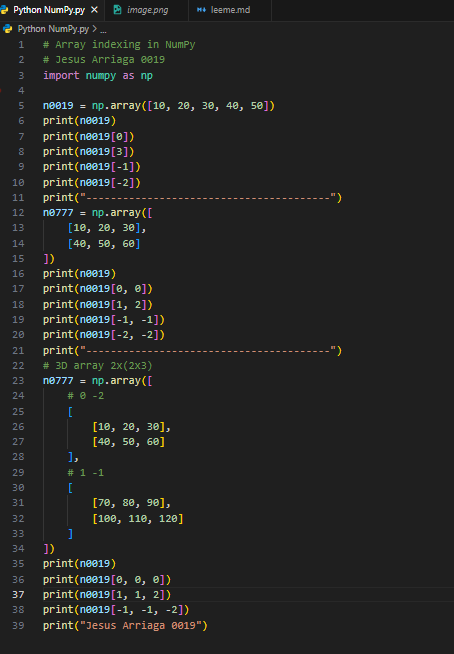
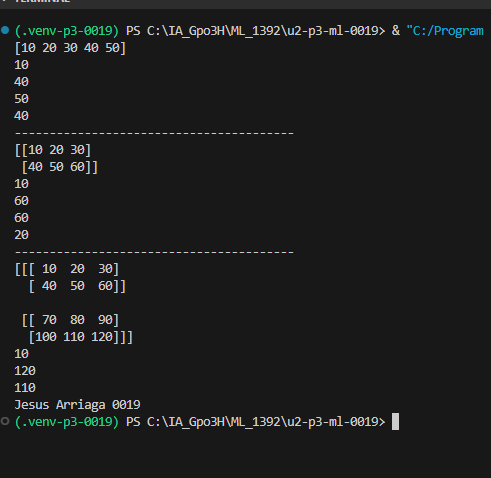

# Array indexing in NumPy

# Descripción
Este programa reproduce el ejercicio de indexación de arreglos de NumPy mostrado en el video. Se utilizan arreglos de una, dos y tres dimensiones para consultar valores mediante índices positivos y negativos.

# el codigo 

# Requisitos
- Python 3
- Visual Studio Code
- Biblioteca NumPy

# Instalación
En la terminal de Visual Studio Code, ejecuta:
python -m pip install numpy

# Cómo ejecutar
1. Abre esta carpeta en Visual Studio Code.
2. Abre el archivo main.py.
3. Ejecuta en la terminal:
python main.py

# resultados 

# ¿Qué se practica?
- Crear arreglos NumPy con np.array().
- Acceder al primer elemento mediante el índice 0.
- Utilizar índices negativos para contar desde el final.
- Consultar elementos de matrices de dos dimensiones usando fila y columna.
- Consultar elementos de un arreglo de tres dimensiones usando tres índices.

# Conclusión
La indexación permite localizar valores concretos dentro de arreglos. Este ejercicio muestra cómo cambia la forma de acceder a los datos según el número de dimensiones.
